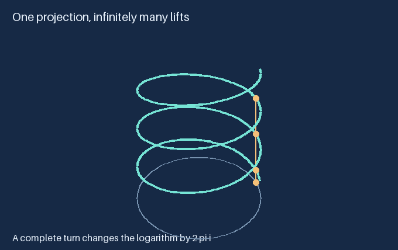

# An infinitely sheeted envelope of holomorphy for a round Bochner tube at infinity

 ·  · 

Both parts of Hazra’s Open Question 2.3 have negative answers. There is a domain in complex dimension two with a centered round disk tube type and infinitely many points of its envelope over each point of one projected circle.

[Read the complete manuscript](paper/manuscript.pdf) · [Proof in Markdown](proof/PROBLEM_AND_PROOF.md) · [Download offline 3D illustration](https://raw.githubusercontent.com/DannyExperiments/bochner-tube-infinite-sheets/v1.0.0/visualization/construction-explorer.zip) · [Reproduction instructions](REPRODUCIBILITY.md)

## Proof

An affine image of the Hazra–Porten spiral provides a lifted half-infinite circle. A polynomial has winding number one on that circle and maps the full prescribed exterior into a half-plane. Compatible logarithms glue over the seed, connector and exterior. In the envelope the logarithm gains 2πi per turn, distinguishing the points above each fixed phase.

## Prior work and scope

Hazra–Porten’s published truncated-tube construction supplies the bounded seed. Their seed does not provide the exterior in Hazra’s later question. Bochner’s theorem gives schlichtness for a full tube. Our construction keeps the seed’s winding detectable after attaching the entire round tube tail. The smooth connected boundary belongs to the real disk tube type. The result is in complex dimension two and makes no claim about global smoothness of the domain boundary or the full envelope geometry. See the [literature audit](audits/public_safe_reports/LITERATURE_AUDIT.md).

## Checks

The exact rational replay checks the seed, exterior and connector inequalities and the polynomial identity on rational unit-circle points. The proof supplies the continuation and winding argument. The artifacts include a standard-library Python replay. The analytical proof is informal in the proof-assistant sense. The [independent mathematical audit](audits/public_safe_reports/MATHEMATICAL_AUDIT.md) passed the theorem. This manuscript has not been peer reviewed.

## Citation

The [citation file](CITATION.cff) gives the project citation identity and version. See [AI disclosure](AI_DISCLOSURE.md) for technical roles.
